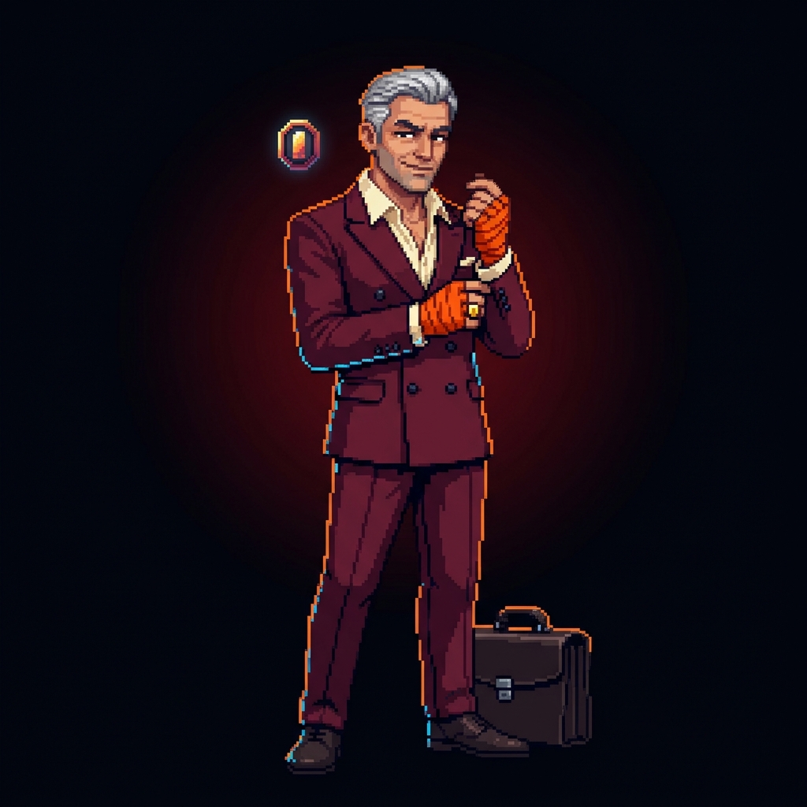
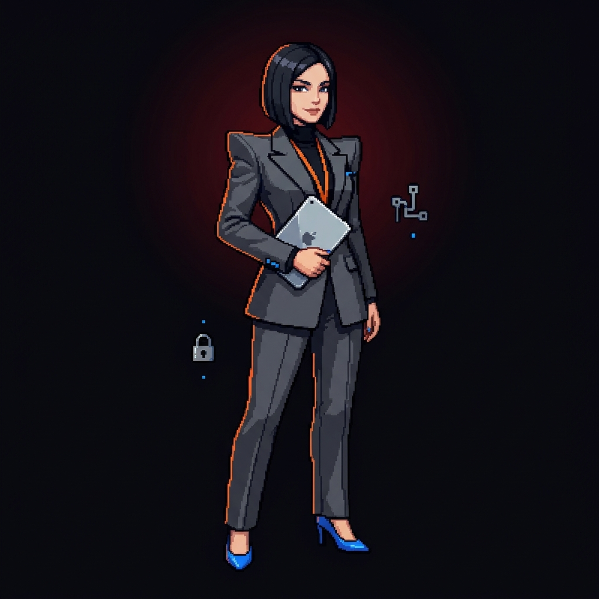
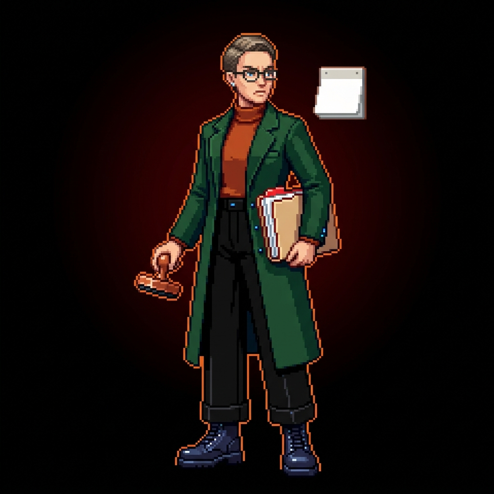
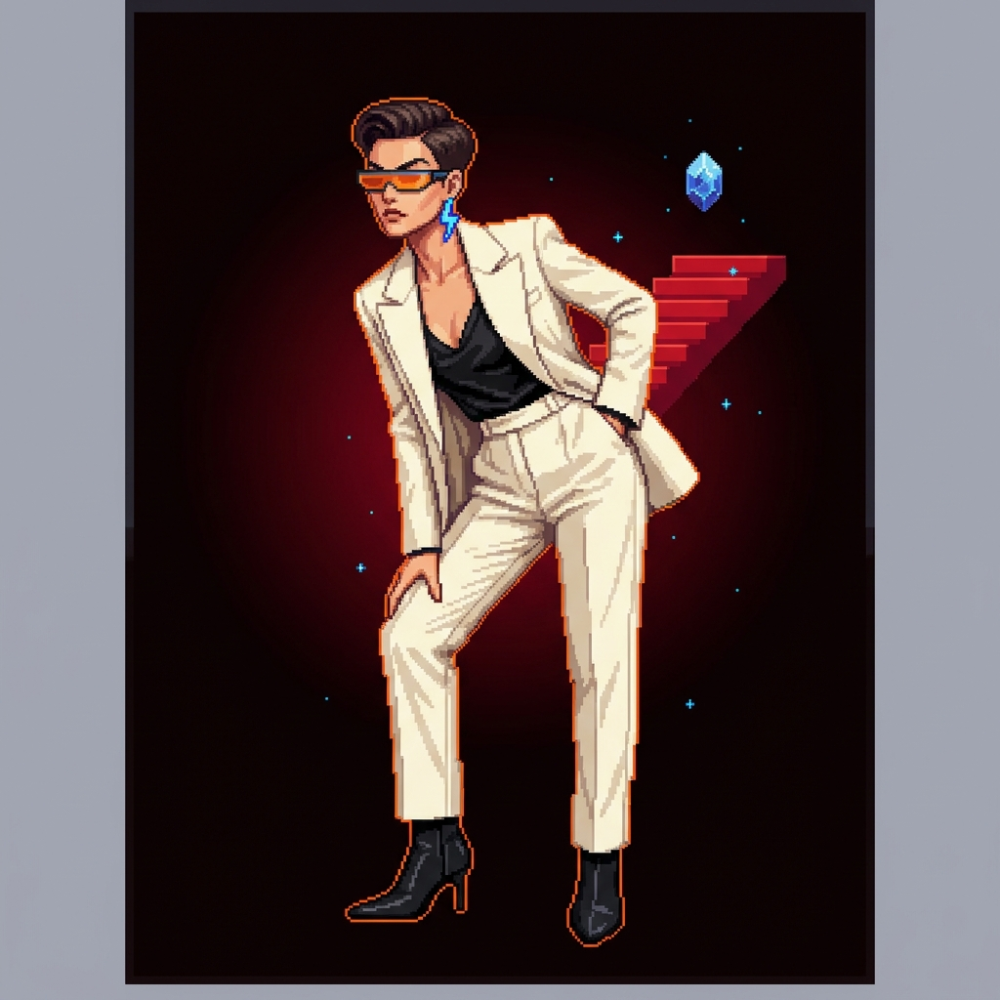
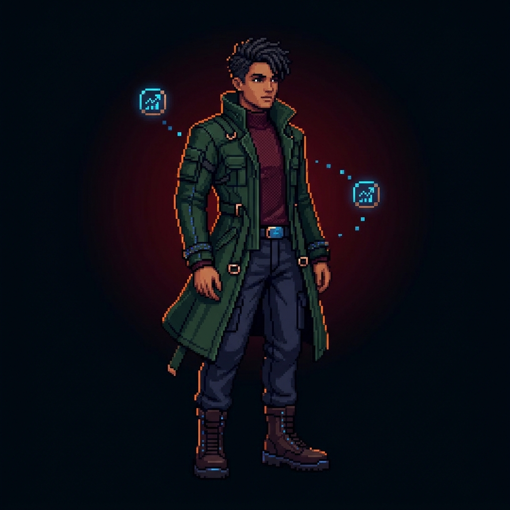

# Investfy: инвесторы, визуал от Ники

Ника передала эти пять изображений 06.11.2026 с указанием: «это наши инвесторы», использовать для сайта и Telegram-бота. Это актуальный визуальный источник; изображения важнее прежних описаний одежды в промптах. Файлы скопированы без редактирования, обрезки, конвертации и изменения качества. Размеры и SHA-256 — в [manifest.json](manifest.json).

| Файл | Роль / подпись | Как узнать |
|---|---|---|
| [01-angel.jpg](01-angel.jpg) | Бизнес-ангел — «Золотой локоть» | Седой мужчина, бордовый костюм, оранжевые бинты, портфель |
| [02-corporate.jpg](02-corporate.jpg) | Корпорация — «Мадам Протокол» | Чёрное каре, графитовый костюм, планшет, синие туфли |
| [03-grant.jpg](03-grant.jpg) | Грантовый фонд — «Комиссар Смета» | Зелёное пальто, очки, папка и печать |
| [04-venture.jpg](04-venture.jpg) | Венчурный фонд — «Леди Икс» | Светлый костюм, оранжевые очки, лестница и синий кристалл |
| [05-custom.jpg](05-custom.jpg) | Пятый авторский инвестор — имя/соответствие уточнить у Ники | Тёмные волосы, длинное зелёное пальто, бордовая водолазка, синие значки роста |

Первые четыре роли сопоставлены с ранее согласованными описаниями персонажей. Пятый визуал не похож на оранжевую шубу Хайп-Алхимика из прежнего промпта: не приписывать ему новое имя или характер автоматически. Можно использовать нейтральное имя файла до уточнения. Все пять визуалов одобрены Никой как комплект, но выбор рабочего AI-персонажа остаётся отдельной договорённостью команды.

## Для разработчиков

- Герман/Влад: использовать для карточек сайта; Иван: для карточки инвестора и ответов бота. Перед подключением выполнить `git pull --rebase`.
- Оригиналы — квадратные JPG с готовым фоном, **без прозрачности и анимации**. Не растягивать под старый макет 4:5: сохранять пропорции, `object-fit: contain`. Первый рисунок содержит серую внешнюю рамку — это часть полученного оригинала; здесь она не удалена.
- Для веба при необходимости сделать отдельные оптимизированные копии в своей зоне, оригиналы оставить неизменными. Бот может отправлять локальный JPG; путь подключает владелец `bot/`. Репозиторий может требовать авторизации: raw GitHub URL не считать гарантированно публичным URL для Telegram.
- Нет новых спрайтов, вырезанного фона или GIF. Не обещать боевую анимацию из одного JPG. Для движения использовать эти изображения как референсы в промптах и согласовывать результат с Никой.

## Галерея

